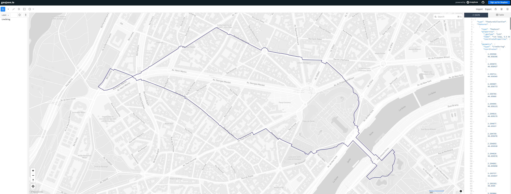

# Loopsmith

Describe a run or a walk in plain language, get a GPX loop for your watch or phone.
A small **open-weight model runs locally** to understand the request; the route itself is computed by an
open-source routing engine on OpenStreetMap data. Nothing leaves your machine.

> "A 6 km easy run, ending where I start" → `loop.gpx`

Built for the DEV Hacktoberfest Open-Source AI Challenge, week 1 ("Touch Grass"): the point is to get people
off the screen. The screen is used for ten seconds, then you go outside.

## Example

"A 6 km easy run, ending where I start", from a fictitious start point (the Eiffel Tower), gives this
5.5 km loop:



Map: [geojson.io](https://geojson.io) (© Mapbox, © OpenStreetMap contributors).

## How it works

```
 free text ──► OllamaIntentParser ──► RouteIntent (validated) ──► GraphHopper round trip ──► GPX
               (local open-weight       distance 1–42 km,          (OpenStreetMap, foot       (XML-escaped,
                model, JSON schema)     RUN | WALK only)            profile, 5 candidate       no personal data)
                                                                    seeds, roundest wins)
```

The model's only job is to turn text into two fields. It never chooses coordinates, never calls a tool, and
its output is validated by `RouteIntent` before anything else happens. If the model is unavailable or
returns something invalid, a deterministic parser takes over (`RuleBasedIntentParser`).

### Choosing the loop

The routing engine treats the requested distance as a hint and tends to undershoot, and its loops can be
thin: out along one street, back along the next. So the service builds several candidates (one per seed),
and keeps the roundest one among those within 10% of the requested length (`RouteShape.roundness`, the
isoperimetric quotient: 1 for a circle, close to 0 for an out-and-back). If none is close enough, it asks
once more with a corrected distance, capped at 1.5x.

## Quick start

Requirements: Java 21, Maven, Docker.

```bash
# 1. Map data (about 400 MB for Île-de-France; pick any Geofabrik extract). Checksum is verified.
scripts/fetch-osm.sh europe/france/ile-de-france

# 2. Local services (Ollama + GraphHopper), published on 127.0.0.1 only
docker compose up -d
docker compose exec ollama ollama pull qwen2.5:3b

# 3. The app
mvn spring-boot:run
# open http://127.0.0.1:8080
```

API:

```bash
curl -s http://127.0.0.1:8080/api/routes \
  -H 'Content-Type: application/json' \
  -d '{"prompt":"a 6 km easy run","lat":48.8584,"lon":2.2945}'
```

## Security and privacy notes

- The server listens on `127.0.0.1` only. If you expose it, add authentication first.
- The model output is untrusted: schema-constrained, validated, bounded (1–42 km), and the system prompt
  tells the model to treat the user's text as data. The user's text and coordinates are never logged.
- Your start point is sensitive (it is usually your home). `*.gpx` is git-ignored; use a fictitious start
  point in screenshots, demos and posts.
- Check the licence of the model you pull before redistributing anything built on it.
- The Docker images are pinned by digest in `docker-compose.yml`. Update them deliberately, not through `latest`.

## Tests

```bash
mvn test
```

Unit tests cover the validation of the intent, the rule-based parser and the GPX writer (including XML
escaping). The Ollama and GraphHopper clients are not covered by automated tests yet (see roadmap).

## Roadmap

- [x] Intent extraction with a local model and a deterministic fallback
- [x] Round-trip routing, best of N candidate seeds, GPX export
- [x] Length calibration: one corrective pass when the best loop is more than 10% off
- [x] Prefer round loops over thin out-and-backs
- [x] Verify `graphhopper/config.yml` and the compose command against the pinned GraphHopper version (12.0)
- [ ] Map preview in the web page (Leaflet bundled locally, no CDN)
- [ ] "Hunt for the good stuff": prefer paths, parks and viewpoints with a GraphHopper custom model
- [ ] Contract tests for both clients with a mock HTTP server
- [ ] Optional: ask the model for a one-line description of the route

## Credits

Map data © [OpenStreetMap contributors](https://www.openstreetmap.org/copyright) (ODbL).
Routing by [GraphHopper](https://github.com/graphhopper/graphhopper). Local inference by
[Ollama](https://ollama.com).

## License

[MIT](LICENSE)
